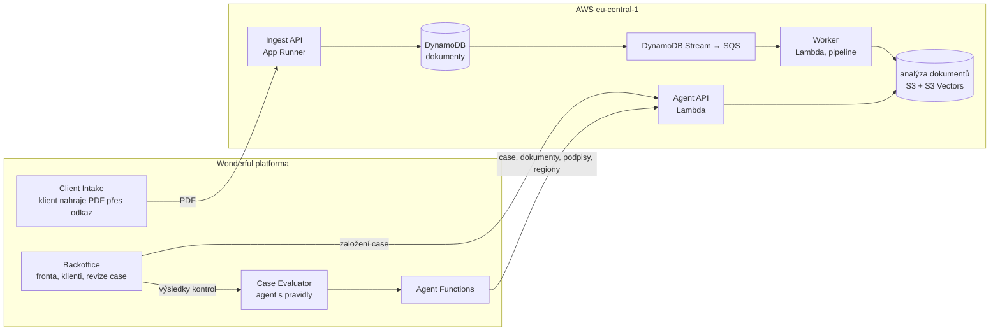

# Wonderful KB: kontrola úvěrových podkladů s AI agentem

Hackathonový projekt pro **Komerční banku (Track 6: Finance operations and back-office AI)**. Back-office před čerpáním úvěru ručně kontroluje balík dokumentů: smlouvu o úvěru, fakturu, předávací protokol, vinkulaci pojištění, zajišťovací převod a další. Ověřuje, že žádný nechybí, že údaje mezi nimi sedí a že jsou podepsané.

Tady to dělá AI agent. Dokumenty rozpozná, vytěží z nich data, zkontroluje úplnost a konzistenci a pracovníkovi banky předá **jen výjimky, každou s odkazem na místo v dokumentu, ze kterého vychází**. O čerpání vždy rozhoduje člověk; agent jen připraví podklady a zdůvodnění.

> Všechna data v repu i v testovacím prostředí jsou **syntetická** (smyšlené firmy jako *Plastovra Výroba s.r.o.*, IČO z řady 98007xxx). Repozitář je veřejný, proto v něm nejsou adresy služeb, číslo AWS účtu ani klíče (viz [Bezpečnost](#bezpečnost-a-soukromí)).

## Jak to funguje



1. **Case.** Pracovník v Backoffice vybere klienta (podle názvu nebo IČO) a založí case. Klient dostane odkaz na Client Intake a nahraje PDF.
2. **Příjem.** Ingest API uloží originál do S3 a zapíše řádek dokumentu. Stejný obsah se nezapíše dvakrát, nahrání je „všechno, nebo nic“.
3. **Zpracování.** Nový řádek automaticky spustí pipeline: stream → fronta → worker. Pipeline nejdřív **zamaskuje podpisy** a dál čte jen zamaskovanou kopii. Pak provede:
   - čtení textu (textová vrstva, u skenů vision model)
   - klasifikaci typu dokumentu (smlouva, faktura, protokol, …)
   - embeddingy a vyhledání podobných ověřených dokumentů
   - detekci podpisů, jejich rolí a podezření na kopii
   - **regiony**, tedy odstavce, položky a řádky tabulek s polohou a štítkem
4. **Vyhodnocení.** Case Evaluator si přes Agent API načte case a dokumenty a projde pravidla:
   - **úplnost**: jsou tam všechny požadované podklady?
   - **obsah**: má každý dokument povinná pole a podpisy?
   - **konzistence**: sedí dodavatel, IČO, předmět, výrobní číslo a částky napříč dokumenty?
   - **stav klienta**

   Každé pravidlo zapíše výsledek se zdůvodněním.
5. **Rozhodnutí.** Pracovník v Backoffice vidí stav každého dokumentu (splněno, chybí, nesoulad, nelze ověřit) a nález vyznačený přímo na straně dokumentu. Čitelný podpis nebo originál si odkryje jen výslovnou akcí a odkrytí se auditně zapíše.

Na syntetickém případu se 6 PDF trvá cesta od nahrání po poslední zpracovaný dokument kolem 1,5 minuty.

## Co je v repu

| Složka | Co to je | Kde běží |
|---|---|---|
| [`apps/backoffice`](apps/backoffice) | UI pro pracovníka banky: pracovní fronta, klienti, založení case, revize dokumentů a výsledků kontrol | Wonderful app |
| [`apps/client-intake-fe`](apps/client-intake-fe/README.md) | stránka pro klienta: přes sdílený odkaz vidí svůj case a nahraje PDF | Wonderful app |
| [`apps/case-explorer`](apps/case-explorer/README.md) | interní testovací konzole: obsah tabulek přes API, ruční spuštění evaluatoru | Wonderful app |
| [`apps/agent-functions`](apps/agent-functions/README.md) | Functions a tabulky pro evaluator: drží klíče, přepínač live/mock | Wonderful Functions |
| [`agents/case-evaluator`](agents/case-evaluator/README.md) | **vyhodnocovací agent**: pravidla úplnosti, obsahu a konzistence, verdikt case | Wonderful agent |
| [`be-intake`](be-intake/README.md) | **Ingest API**: multipart upload PDF (až 20 souborů, 25 MB na soubor), deduplikace, kontrakt [`openapi-ingest.yaml`](be-intake/openapi-ingest.yaml) | AWS App Runner |
| [`be-validator-agent`](be-validator-agent/README.md) | **zpracování dokumentů a Agent API**: pipeline, klasifikace, embeddingy, podpisy, maskování, regiony, deduplikace, trigger, referenční agent, evaluace | AWS Lambda, S3, DynamoDB, S3 Vectors |
| [`be-document-processing`](be-document-processing/README.md) | samostatná služba OCR a vytěžení firemních údajů (PyMuPDF + Bedrock vision) a **kontrakty API** v [`contracts/`](be-document-processing/contracts) | lokálně / AWS |
| [`design-system`](design-system) | vizuální jazyk KB (tokeny, komponenty, písma) | — |
| [`architecture`](architecture) | stavy [case](architecture/case-statuses.md) a [dokumentů](architecture/document-statuses.md) | — |
| [`docs`](docs) | [rychlé připojení k API a DB](docs/quick-connect.md), architektonické poznámky, návrhy | — |
| `plans`, `learnings` | pracovní plány a poučení agentů z vývoje | — |

## API na jeden pohled

Obě služby chrání stejný klíč v hlavičce `x-api-key`.

| Služba | Hlavní volání | Kontrakt |
|---|---|---|
| **Agent API** | `GET /clients`, `POST /cases`, `GET /cases/{id}`, `GET /cases/{id}/documents`, `…/documents/{d}` (text, štítek), `…/vectors`, `…/signatures`, `…/pages` (zamaskované strany), `…/original` (odkrytí, audit), `…/regions` | [`openapi-validator-agent.yaml`](be-document-processing/contracts/openapi-validator-agent.yaml) |
| **Ingest API** | `POST /cases/{id}/documents` (multipart), `GET /cases/{id}/documents` | [`openapi-ingest.yaml`](be-intake/openapi-ingest.yaml) |

Návod pro vyhodnocovacího agenta (tři volání, nástroje, návrh promptu): [`be-validator-agent/docs/wonderful-validator-agent.md`](be-validator-agent/docs/wonderful-validator-agent.md). Předávka pro Wonderful: [`be-validator-agent/HANDOVER.md`](be-validator-agent/HANDOVER.md).

## Stavy

Stavy **case** ([detail](architecture/case-statuses.md)):

```
open → intake_in_progress → evaluating → awaiting_decision → approved → completed
                                              ↕
                                   awaiting_clarification
```

Stav **dokumentu** v kontrole ([detail](architecture/document-statuses.md)): `pending`, `fulfilled`, `missing`, `mismatch`, `unverifiable`. Dokument nese nejhorší stav ze svých nálezů.

Stav **zpracování** dokumentu v pipeline: `queued → processing → completed | partial | failed`. Selhání se třikrát opakuje, pak dokument skončí v DLQ jako `failed` s důvodem. Detail je v [`be-validator-agent/trigger`](be-validator-agent/trigger/README.md).

## Technologie

- **AWS `eu-central-1` (Frankfurt), jen tam.** App Runner, Lambda (kontejnerový worker), DynamoDB a jeho Streams, SQS s DLQ, S3, S3 Vectors, KMS, Secrets Manager.
- **Modely v Amazon Bedrocku:**

  | Model | K čemu |
  |---|---|
  | Claude Haiku 4.5 | klasifikace, štítky regionů |
  | Qwen3 VL | čtení skenů |
  | Titan Text / Image Embeddings | vektory |
  | Textract | detekce podpisů |

- **Wonderful platforma:** aplikace (React + Vite), Functions, tabulky, agent s nástroji (TypeScript).
- **Python 3.14** pro backend (PyMuPDF, pypdfium2, boto3), testy proti `moto`, bez AWS.

## Spuštění a testy

Každá část má vlastní README s přesnými příkazy. Nejčastěji:

```bash
# testy zpracování dokumentů (bez AWS; vzorová PDF nejsou v repu, cestu k nim dává proměnná)
cd be-validator-agent/pipeline && python3 -m venv .venv && .venv/bin/pip install -r requirements-dev.txt
WONDERFULKB_SAMPLES_DIR=/cesta/k/vzorove-dokumenty .venv/bin/python -m pytest
```

```bash
# Backoffice lokálně (Node.js 24+, přístup do privátního Wonderful registru kvůli @wonderful/ui-base)
cd apps/backoffice/app && pnpm install && pnpm runner
```

Lokální runner přeposílá `/document-api/*` na backend. Klíče jsou jen serverové proměnné a do prohlížeče se nikdy nedostanou. Nasazení do AWS popisují README jednotlivých služeb (`deploy.sh`, SAM šablony).

Wonderful aplikace a agenti mají vlastní vnořený git s `origin` na Wonderful VCS. Změna se nasazuje tam a zároveň commituje sem (viz [`AGENTS.md`](AGENTS.md)).

## Bezpečnost a soukromí

- **Podpisy se nikde neukládají čitelně.** Pipeline je zamaskuje dřív, než dokument čte cokoli dalšího. Výřezy jsou šifrované přes KMS a odkrýt je smí jen API, na výslovnou akci člověka a s auditním záznamem. Podrobnosti: [`validator-agent-privacy.md`](be-validator-agent/docs/validator-agent-privacy.md).
- **Klíče zůstávají na serveru:** v AWS Secrets Manageru a ve Wonderful secrets, nikdy v prohlížeči ani v repu.
- **V repu nejsou skutečné adresy, číslo účtu ani ID klíčů.** Jsou nahrazené zástupnými symboly (`<AGENT_API_BASE_URL>`, `<INGEST_API_BASE_URL>`, `<ACCOUNT_ID>`, `<KMS_KEY_ID>`) a skutečné hodnoty se předávají mimo repozitář.
- **Vzorová PDF z hackathonového balíku nejsou v repu.** Testy a evaluace je čtou z cesty v `WONDERFULKB_SAMPLES_DIR`.

## Tým

Vzniklo na hackathonu 19.–20. 10. 2026 ve spolupráci týmu WonderfulKB a [Wonderful](https://wonderful.ai). Velkou část kódu, testů a dokumentace psali AI agenti (Claude Code) pod vedením týmu; jejich plány a poučení jsou v `plans/` a `learnings/`.
