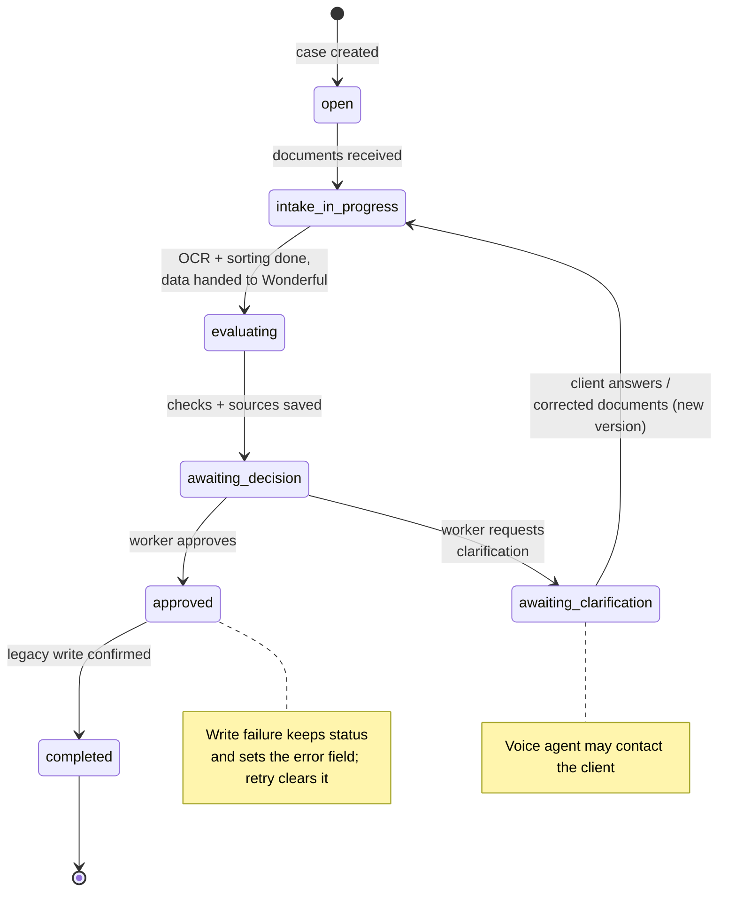

# Case statuses

Lifecycle of an underwriting case (`status` attribute in `wonderfulkb-uw-cases`).

| Value | Czech | Meaning | Owner |
|---|---|---|---|
| `open` | Čeká na podklady | Case exists, waiting for documents | Client / KB |
| `intake_in_progress` | Příjem podkladů | Documents received; OCR, classification and building the hand-over data | KB |
| `evaluating` | Vyhodnocuje se | Agents consolidate data and run the agreed checks | Wonderful |
| `awaiting_decision` | K rozhodnutí | KB worker reviews the current document version, check results and reasoning | KB worker |
| `awaiting_clarification` | Čeká na doplnění | Worker requested additional documents or an explanation; the voice agent may contact the client | Wonderful: contact; KB: intake |
| `approved` | Schváleno | Worker approved a specific document version; write to the legacy app is pending or running | KB: decision; Wonderful: write |
| `completed` | Dokončeno | Legacy app confirmed the write and the confirmation is stored on the case. Terminal status | Wonderful |

## Who writes the status

| Status | Written by | When |
|---|---|---|
| `open` | agent API, `POST /cases` | case created |
| `intake_in_progress` | trigger, `wonderfulkb-trigger-enqueue` | a new document is queued for processing, only from `open` or `awaiting_clarification` |
| `evaluating` | trigger, case step in `wonderfulkb-trigger-worker` | every document of the case is in a final state (`completed`, `partial`, `failed`) and the Wonderful webhook accepted the case (`POST …/tasks/webhook/<id>`, body `{"payload": {"case_id": "<case_id>"}}`); only from `open` or `intake_in_progress` |
| everything else | Wonderful, `PUT /cases/{case_id}/status` with `{"status": "<status>"}` | as the agent and the worker move the case on |

Each write also sets `status_updated_at`. The webhook URL and its `X-Webhook-Secret` are in the Secrets Manager secret `wonderfulkb/wonderful-webhook`, not in the repository.

## State machine

## Design notes

- **No separate "ready" status (Připraveno).** The hand-over from KB to Wonderful triggers consolidation immediately, so `intake_in_progress → evaluating` covers it.
- **No separate "writing" status (Zapisuje se).** The legacy write starts automatically after approval; `approved` means "approved, being written".
- **`approved` vs `completed`.** `approved` is the business decision; the data is not in the legacy app yet and the write can fail. `completed` is the technical confirmation that the legacy app accepted it. Keeping both distinguishes "decided but not yet in the legacy system" from "done".
- **Technical problems are not a status (Technický problém).** The case keeps the status of the interrupted step (`intake_in_progress`, `evaluating` or `approved`) and gets an `error` field (message, failed step, timestamp). A controlled retry clears it and resumes that step.
- **Clarification loops back to intake.** Answers and corrected documents are stored as a new document version and go through OCR again.

## Open questions

- Add `rejected` (Zamítnuto)? `awaiting_decision` currently allows only approval or a clarification request.
- Confirm the `error` field over a dedicated `failed` status.
- The agent API does not check transitions: Wonderful can set any status. Enforce the state machine there?
